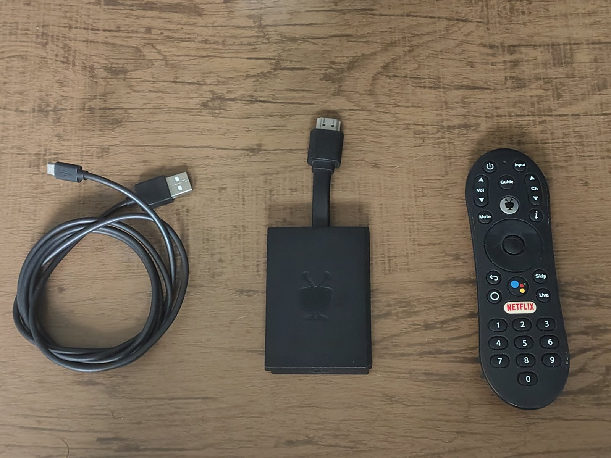
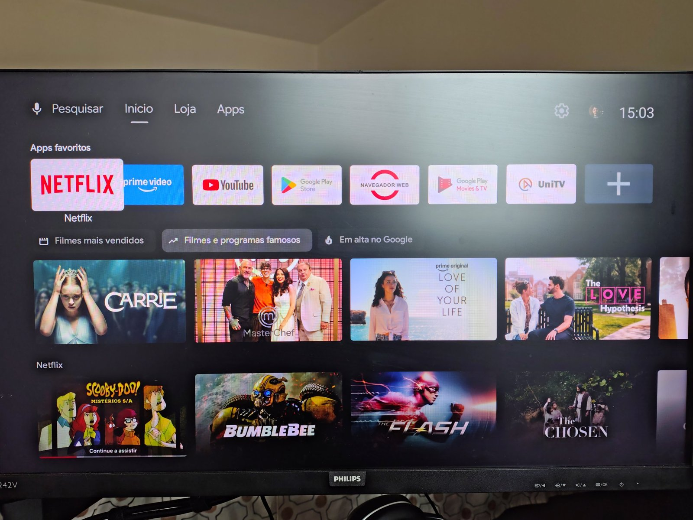

# TiVo Stream 4K Debloat

> Transformando um TiVo Stream 4K de 2020 num Android TV enxuto: sem propaganda, sem bloat, com cada mudança medida e reversível.



**Status:** 🟡 Fase 0 — documentação e preparação. Nada foi alterado no aparelho ainda.

---

## Por que este projeto

O TiVo Stream 4K é um bom aparelho preso a um sistema que envelheceu mal: tela inicial cheia de recomendações patrocinadas, serviços rodando em segundo plano e, desde a atualização para o Android 12, um app de sistema (`com.nes.coreservice`) que **desinstala sozinho** launchers alternativos e ferramentas de ADB.

O objetivo aqui não é "deixar mais potente" (o chip continua o mesmo), e sim **parar de desperdiçar o pouco que ele tem**, e provar isso com números.


*Home original: linha de apps com Play Movies, abas "Loja" e linhas de recomendação que ninguém pediu.*

## Princípios

1. **Sem root, sem flash.** Tudo via ADB pela rede. O bootloader do TiVo é travado e não existe ROM customizada para ele.
2. **Desabilitar, nunca desinstalar.** `pm disable-user` volta com um comando ou pelas próprias Configurações.
3. **Medir antes de mexer.** Toda mudança agressiva só entra se o benchmark mostrar que vale a pena.
4. **Lotes pequenos.** Um grupo de pacotes por vez, teste com o controle, reboot, anota.
5. **Upstream primeiro.** O que funcionar vira PR no [cleanyourtv](https://github.com/Gathin23/cleanyourtv).

## O aparelho

| | |
|---|---|
| Modelo | TiVo Stream 4K, `IPA1104HDW`, SKU `RA2400` |
| Fabricante real (ODM) | SEI Robotics (FCC ID `2AOVU-IPA1104HDW`) |
| SoC | Amlogic S905Y2 — 4× Cortex-A53, GPU Mali-G31 MP2 |
| RAM / armazenamento | 2 GB / 8 GB |
| Sistema | Android TV 12 (build 1272, SDK 31), launcher clássico `com.google.android.tvlauncher` |
| Middleware | NES (pacotes `com.nes.*`), a mesma do Nokia Streaming Box 8000 e do Dialog ViU |

Detalhes e o porquê de cada linha em [docs/00-hardware.md](docs/00-hardware.md).

## Antes × depois

> Preenchido pelo `scripts/bench.sh`. Mesma TV, mesma rede, média de 3 rodadas.

| Métrica | Antes | Depois | Δ |
|---|---|---|---|
| RAM disponível em repouso (MemAvailable) | — | — | — |
| Processos rodando | — | — | — |
| Pacotes habilitados | — | — | — |
| PSS do launcher | — | — | — |
| Tempo de boot até `sys.boot_completed` | — | — | — |
| Abertura a frio do YouTube (`am start -W`) | — | — | — |
| Abertura a frio da Netflix | — | — | — |

## Roteiro

| Fase | O quê | Doc |
|---|---|---|
| 0 | Fotos do "antes", ADB ligado, probe e inventário completo | [01-preparacao](docs/01-preparacao.md), [02-inventario](docs/02-inventario.md) |
| 1 | Benchmark de linha de base | [06-benchmark](docs/06-benchmark.md) |
| 2 | Investigar e neutralizar o CoreService | [03-coreservice](docs/03-coreservice.md) |
| 3 | Debloat em lotes | [04-debloat](docs/04-debloat.md) |
| 4 | Launcher novo | [05-launcher](docs/05-launcher.md) |
| 5 | Benchmark final + uso real por alguns dias | [06-benchmark](docs/06-benchmark.md) |
| 6 | PR no cleanyourtv | [07-upstream](docs/07-upstream.md) |

O diário de bordo, com data, comando e resultado de cada passo, fica em [docs/diario.md](docs/diario.md).

## Uso rápido (para o próximo dono de um TiVo Stream 4K)

```bash
git clone https://github.com/lucaswotta/tivo-stream-4k-debloat && cd tivo-stream-4k-debloat
export TV_HOST=192.168.0.50          # IP do seu TiVo

scripts/probe.sh                     # inventário do aparelho em runs/<data>/
scripts/bench.sh antes               # linha de base
scripts/apply.sh examples/tivo-stream-4k/debloat.txt
scripts/bench.sh depois
scripts/rollback.sh examples/tivo-stream-4k/debloat.txt   # desfaz tudo
```

> ⚠️ A lista em `examples/tivo-stream-4k/debloat.txt` ainda é um **rascunho não testado**. Não aplique antes de ela sair da Fase 3.

## Créditos e base

- [Gathin23/cleanyourtv](https://github.com/Gathin23/cleanyourtv) (ex-tv-vibehack), MIT — formato das listas, ferramentas e o launcher. As listas do Nokia Streaming Box 8000 e do Dialog ViU (mesma fabricante e middleware) são o ponto de partida deste trabalho.
- free-my-tv — *(link a confirmar)*.

## Licença

MIT. Use por sua conta: desabilitar o pacote errado pode quebrar recursos. Tudo aqui é reversível, mas leia antes de rodar.
