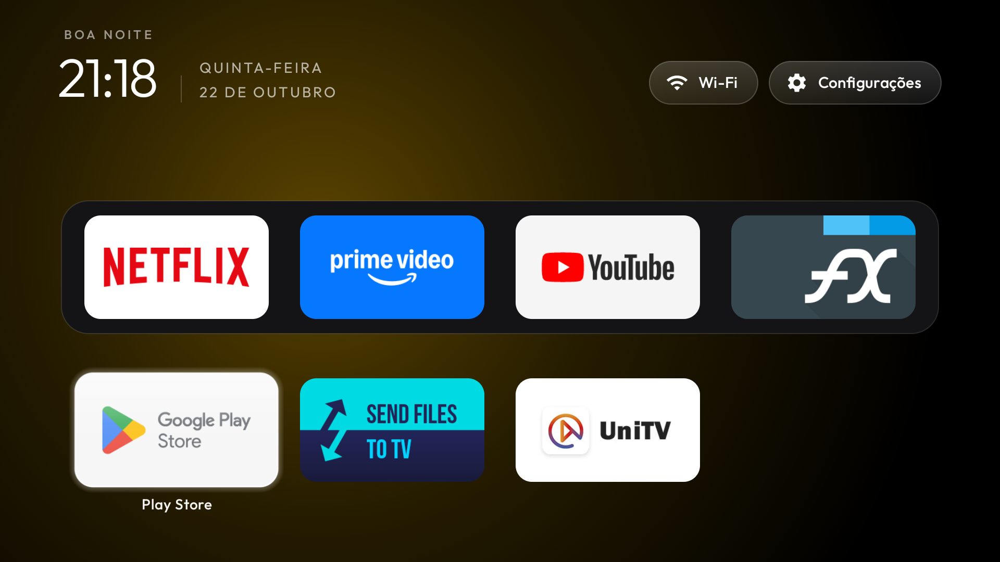
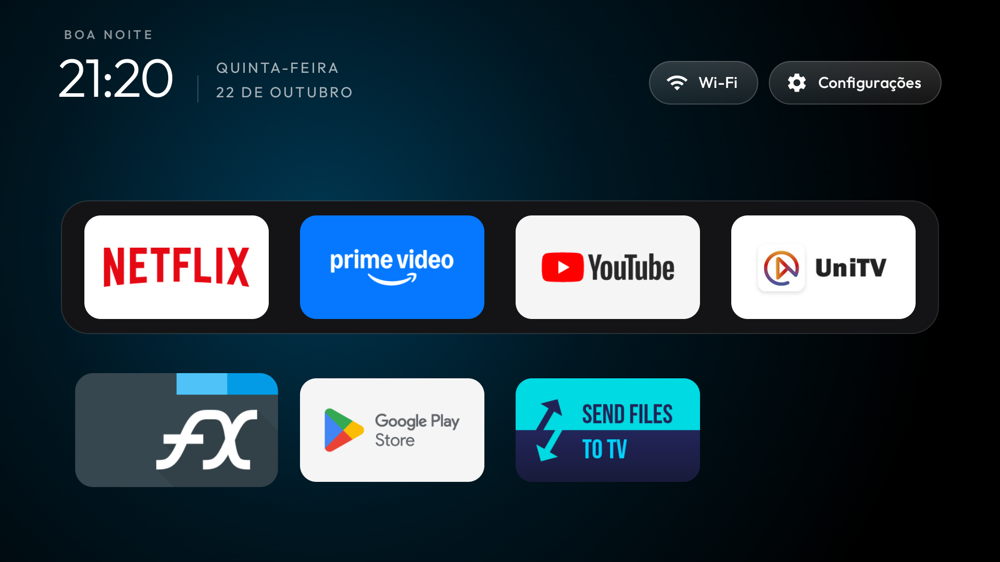

# TiVo Stream 4K Debloat

Scripts, patches e notas para um TiVo Stream 4K (Android 12) sem os serviços da operadora, com um launcher leve e a tecla Home funcionando, sem root e sem desinstalar nada do sistema.

| De fábrica | Base (`apply-all.sh`) | Preferências do dono (`personal.sh`) |
|---|---|---|
|  |  |  |

Validado em uma unidade (`IPA1104HDW`, build `SC.1272`, patch 2025-07-05), em um dia de uso e vários reboots.

## Antes e depois

| | De fábrica | Agora |
|---|---|---|
| Tela inicial | Android TV Home: linhas de recomendação, aba Loja, 60 a 100 MB de memória | launcher do cleanyourtv, 22 MB, sem rede |
| `com.nes.coreservice` | consulta o status de atualização 1 vez por segundo e apaga launchers alternativos e apps de sideload | suspenso e parado a cada boot; a consulta caiu a zero |
| Serviços da NES e da TiVo, telemetria, recomendações | rodando em segundo plano | 14 pacotes suspensos, nada desinstalado |
| Tecla Home | abre o launcher original, que ninguém substitui por `set-home-activity` | abre o novo, por um serviço de acessibilidade de 13 KB |
| Depois de um boot | tudo religa | o `bootclean` (17 KB) para os 5 processos que o boot religa |
| Memória livre | 920 MB (original com 10 pacotes suspensos; sem suspender nada, não medido) | 1014 a 1151 MB |

O que ficou igual: o chip (Amlogic S905Y2, 4 núcleos até 1,8 GHz, 2 GB de RAM), o tempo de boot (48 s) e a abertura dos apps de streaming. Nada aqui acelera o processador.

## Instalação

Requisitos: TiVo Stream 4K com **Depuração USB ligada** (Configurações, Preferências do dispositivo, Sobre, 7 toques em Build) na mesma rede do computador Linux com `adb`, `curl`, `python3`, `unzip`, `tar` e `git`, e uns 1,5 GB livres para as ferramentas de build. O script baixa JDK 17 e o Android SDK sozinho, de fontes oficiais, com checksum.

```bash
git clone https://github.com/lucaswotta/tivo-stream-4k-debloat && cd tivo-stream-4k-debloat
export TV_HOST=192.168.0.50                 # IP do seu TiVo
adb connect $TV_HOST:5555                   # aceite o aviso na TV (Sempre permitir)

scripts/apply-all.sh --dry-run              # o plano, sem alterar nada
scripts/apply-all.sh                        # explica os efeitos, pergunta, aplica e confere
```

Na primeira execução o `bootclean` pede, na TV, a autorização de depuração USB: marque **Sempre permitir**, com a TV acordada. Depois teste a tecla Home e reinicie; uns 6 minutos depois, `scripts/status.sh` confere tudo.

A base faz: suspende 14 pacotes; troca o launcher (patch de uma linha que tira a categoria HOME); instala o serviço da tecla Home e o `bootclean`; tira o launcher original do papel HOME e o suspende; desliga o ouvinte de notificações do `tvrecommendations`; usa o relógio do launcher como protetor de tela.

Efeitos da base que você precisa aceitar:

- O `bootclean` deixa **uma chave de depuração USB autorizada para sempre** e roda comandos fixos no boot ([docs/10-bootclean.md](docs/10-bootclean.md)). A depuração USB precisa ficar ligada.
- O **Downloader e outros 52 apps** da lista de fábrica do `coreservice` (launchers alternativos, ferramentas de instalação, IPTV) são desinstalados a cada boot. Não dá para impedir sem root ([docs/03-coreservice.md](docs/03-coreservice.md)). Para instalar apps: `scripts/install-apk.sh <arquivo ou link>`.
- Vale para esta versão do firmware; uma atualização do sistema pode desfazer parte.

## Preferências do dono (`scripts/personal.sh`)

Camada separada e opcional, por cima da base. Tudo aqui é gosto, nada é necessário para o resto funcionar:

| O que muda | Como |
|---|---|
| Foco sem borda, sem halo, sem brilho; o app selecionado só cresce 10%, na hora | 3 patches no launcher (`launcher/personal/`) |
| Sem o nome do app embaixo do tile nem o título grande acima do dock | patch `no-app-name` e `dock_title: false` |
| Sem animações; dock com UniTV | `examples/tivo-stream-4k/theme-personal/config.json` |
| Botões do controle: TiVo abre o YouTube, Live o UniTV, Guide as Configurações | `app_keys` e `settings_key_keycodes` do mesmo tema |
| Botão do Assistente abre a Play Store; Assistente do Google desligado e `katniss` suspenso | `AssistActivity` no `homekey` e perfil `personal` do `bootclean` |

```bash
scripts/personal.sh --dry-run      # o plano
scripts/personal.sh                # aplica
scripts/personal.sh --undo         # volta à base
```

Para escolher outros apps ou botões, edite `examples/tivo-stream-4k/theme-personal/config.json` e rode `scripts/push-theme.sh examples/tivo-stream-4k/theme-personal`. Os keycodes do controle estão em [docs/08-controle.md](docs/08-controle.md).

## Desfazer

```bash
scripts/personal.sh --undo                                 # só as preferências pessoais
scripts/rollback.sh examples/tivo-stream-4k/debloat.txt    # reativa todos os pacotes suspensos
scripts/install-launcher.sh --remove                       # tira launcher, serviço e bootclean; a Home volta ao original
```

Antes de um reset de fábrica, rode os três. O Assistente do Google e o ouvinte de notificações voltam pelos comandos de [docs/10-bootclean.md](docs/10-bootclean.md).

## Números medidos

Método, ruído e todas as rodadas: [docs/06-benchmark.md](docs/06-benchmark.md). Mediana de 3 rodadas de `scripts/bench.sh`:

| Métrica | Original, com os 10 primeiros pacotes suspensos | Estado final |
|---|---|---|
| Memória livre (`MemAvailable`) | 920 MB | 1014 a 1151 MB |
| Memória do launcher (PSS) | 64 MB | 22 MB |
| Consulta de atualização do `coreservice` | 1 por segundo (180 em 180 s) | 0 |
| Navegação no launcher, quadros travados | não medido no original | ~0,5% (3 em ~650) |
| Abertura a frio, YouTube / Netflix | 673 / 775 ms | 508 / 491 ms |

A comparação não é perfeita: o "antes" foi medido logo depois de um boot e o "depois" alguns minutos depois, com processos parados à força, então parte do ganho de memória é só o sistema assentar. A abertura de um mesmo app varia 400 a 630 ms entre medições iguais. O ganho firme é memória e atividade em segundo plano.

## Em relação ao cleanyourtv e ao free-my-tv

O launcher é o do [cleanyourtv](https://github.com/Gathin23/cleanyourtv) (MIT) e o cliente ADB do `bootclean` vem do [free-my-tv](https://github.com/simbasjungles/free-my-tv) (MIT).

Faz neste aparelho o que nenhum dos dois faz:

- Troca a Home em um firmware que fixa o launcher: o `examples/` do Nokia 8000 do cleanyourtv registra isso como não resolvido.
- Explica e contorna a remoção de apps pelo `coreservice` (lista de 53 pacotes no firmware e apps com categoria HOME) em [docs/03-coreservice.md](docs/03-coreservice.md).
- Para sozinho, no boot, os processos que o sistema religa mesmo com o pacote suspenso.
- Achou o keycode 5124 do botão Live e o desvio para o botão do Assistente, que nenhum serviço de acessibilidade consegue interceptar ([docs/08-controle.md](docs/08-controle.md)).

Não faz o que eles fazem em geral: mais de 230 aparelhos no cleanyourtv, temas, módulos, biblioteca de apps, testes automatizados e CI, versões para LG e Samsung no free-my-tv. Aqui é um aparelho, uma unidade e um dia de uso.

Enviado ao cleanyourtv: [PR #1061](https://github.com/Gathin23/cleanyourtv/pull/1061) (a lista do aparelho) e [issue #1062](https://github.com/Gathin23/cleanyourtv/issues/1062) (o `coreservice`). A hipótese de que a mesma lista afeta o Nokia Streaming Box 8000 e outros aparelhos SEI/NES não foi testada.

## Estrutura

| Pasta ou script | O que é |
|---|---|
| `scripts/apply-all.sh`, `personal.sh` | base e preferências pessoais, ambos com `--dry-run` |
| `scripts/status.sh [--personal]` | confere o aparelho contra o estado validado (só leitura) |
| `scripts/apply.sh`, `rollback.sh` | suspende e reativa os pacotes da lista (`--only <grupo>`) |
| `scripts/setup-toolchain.sh`, `build-launcher.sh [--personal]`, `build-apk.sh` | ferramentas e compilação |
| `scripts/install-launcher.sh`, `push-theme.sh`, `post-boot.sh`, `install-apk.sh`, `bench.sh`, `probe.sh` | instalar, tema, limpeza manual, instalar APK, medir, inventário |
| `examples/tivo-stream-4k/` | `debloat.txt`, `theme/` (base) e `theme-personal/` |
| `launcher/base/`, `launcher/personal/` | patches sobre o cleanyourtv, em um commit fixado |
| `homekey/`, `bootclean/` | os dois APKs pequenos, sem Gradle; `bootclean/profile/` define o que ele roda |
| `docs/` | uma nota por assunto e o [diário](docs/diario.md), com data, comando e resultado de cada etapa |

Notas: [00 hardware](docs/00-hardware.md), [01 preparação](docs/01-preparacao.md), [02 inventário](docs/02-inventario.md), [03 coreservice](docs/03-coreservice.md), [04 debloat](docs/04-debloat.md), [05 launcher](docs/05-launcher.md), [06 medições](docs/06-benchmark.md), [07 contribuição](docs/07-upstream.md), [08 controle](docs/08-controle.md), [09 referências](docs/09-referencias.md), [10 bootclean](docs/10-bootclean.md).

## Licença

MIT. Suspender o pacote errado pode quebrar recursos; tudo aqui é reversível, mas leia antes de rodar. Créditos: cleanyourtv (launcher, formato das listas), free-my-tv (cliente ADB local, `bootclean/LICENSE-free-my-tv`).
