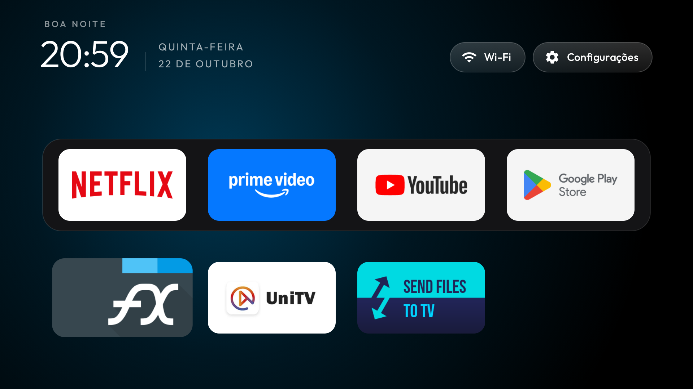

# TiVo Stream 4K Debloat

Scripts, patches e anotações para deixar um TiVo Stream 4K (Android TV 12) sem os serviços da operadora e do fabricante, com um launcher leve, sem root e sem apagar nada do sistema.

|  Antes (de fábrica) | Depois |
|---|---|
|  |  |

Validado em **uma unidade** (TiVo Stream 4K `IPA1104HDW`, Android 12, build `SC.1272`, patch 2025-07-05), em um dia de uso e vários reboots. Não foi testado em outros aparelhos nem por vários dias.

## O que o conjunto faz

- **Suspende 15 pacotes** (telemetria, serviços da NES e da TiVo, recomendações, launcher original, protetor de tela original, Assistente de voz e apps sem uso). Nada é desinstalado por este projeto; tudo volta com `scripts/rollback.sh`.
- **Troca o launcher** pelo do [cleanyourtv](https://github.com/Gathin23/cleanyourtv), com 4 patches (`launcher/`): sem a categoria HOME, sem borda nem halo no foco, com zoom instantâneo e sem nomes embaixo dos apps.
- **Mantém a tecla Home** funcionando com um serviço de acessibilidade de 13 KB (`homekey/`), porque o launcher original não deixa outro assumir a Home neste firmware.
- **Mapeia os botões do controle** que não faziam nada: TiVo abre o YouTube, Live abre o UniTV, Guide abre as Configurações, Assistente abre a Play Store.
- **Para sozinho, a cada boot**, os processos que o sistema religa mesmo com o pacote suspenso (`bootclean/`, um APK de 17 KB).
- **Usa o protetor de tela** do launcher (relógio).

## Requisitos

- Um TiVo Stream 4K com **Depuração USB ligada** (Configurações, Preferências do dispositivo, Sobre, 7 toques em Build, depois Opções do desenvolvedor) e na mesma rede do computador.
- No computador (Linux): `adb`, `curl`, `python3`, `unzip`, `tar`, `git`. O script baixa JDK 17 e o Android SDK sozinho, de fontes oficiais, com checksum.
- Cerca de 1,5 GB livres para as ferramentas de build.

## Instalação

```bash
git clone https://github.com/lucaswotta/tivo-stream-4k-debloat && cd tivo-stream-4k-debloat
export TV_HOST=192.168.0.50                 # IP do seu TiVo
adb connect $TV_HOST:5555                   # aceite o aviso na TV (Sempre permitir)

scripts/apply-all.sh --dry-run              # mostra o plano e o que cada passo faria
scripts/apply-all.sh                        # explica os efeitos, pergunta, aplica e confere
```

Na primeira execução o `bootclean` pede, na TV, a autorização de depuração USB: marque **Sempre permitir**, com a TV acordada (o protetor de tela faz o Android negar o aviso). Depois teste o controle e reinicie a TV; uns 6 minutos depois rode `scripts/status.sh`.

Passo a passo, sem o script único: [docs/01-preparacao.md](docs/01-preparacao.md), [docs/04-debloat.md](docs/04-debloat.md) e [docs/05-launcher.md](docs/05-launcher.md).

## Efeitos que você deve aceitar

- O **Assistente do Google fica desligado** (o botão do Assistente abre a Play Store). O microfone do controle nunca foi testado aqui.
- O `bootclean` mantém uma **chave de depuração USB autorizada para sempre** e roda comandos fixos no boot ([docs/10-bootclean.md](docs/10-bootclean.md)). A depuração USB precisa ficar ligada.
- O **Downloader e outros 52 apps** da lista de fábrica do `com.nes.coreservice` (launchers alternativos, ferramentas de instalação, IPTV) **são desinstalados a cada boot**, e isso não dá para impedir sem root ([docs/03-coreservice.md](docs/03-coreservice.md)). Para instalar apps use `scripts/install-apk.sh <arquivo ou link>`.
- O estado só vale para esta versão do firmware. Uma atualização do sistema pode desfazer parte do que está aqui.

## Desfazer

```bash
scripts/rollback.sh examples/tivo-stream-4k/debloat.txt    # reativa os pacotes suspensos
scripts/install-launcher.sh --remove                       # tira launcher, serviço e bootclean; a Home volta ao original
```

Para devolver o Assistente e o ouvinte de notificações, os comandos estão em [docs/10-bootclean.md](docs/10-bootclean.md). Antes de um reset de fábrica, rode os dois.

## Números medidos

Todos em [docs/06-benchmark.md](docs/06-benchmark.md), com método e limites. Resumo (mediana de 3 rodadas, `scripts/bench.sh`):

| Métrica | Original, com os 10 primeiros pacotes suspensos | Estado final |
|---|---|---|
| Memória livre (`MemAvailable`) | 920 MB | 1014 a 1151 MB |
| Memória do launcher (PSS) | 64 MB | 22 MB |
| Consulta de atualização do `coreservice` | 1 por segundo (180 em 180 s) | 0 |
| Navegação no launcher, quadros travados | não medido no original | ~0,5% (3 em ~650) |
| Abertura a frio, YouTube / Netflix | 673 / 775 ms | 508 / 491 ms |
| Boot até `boot_completed` | 48 s | 48 s |

Limites que mudam a leitura: o "antes" foi medido logo depois de um boot e o "depois" alguns minutos depois, com os processos parados à força, então parte do ganho de memória é só o sistema assentar. Os tempos de abertura variam entre medições iguais (por exemplo 414 a 634 ms para o mesmo launcher). **O ganho firme é de memória e de atividade em segundo plano, não de velocidade.** O chip é de entrada (Amlogic S905Y2, 4 núcleos até 1,8 GHz, Mali-G31, 2 GB) e nada aqui o acelera: governor e frequência são do usuário `system`, e o bootloader é travado.

## Como se compara aos repositórios de referência

Este projeto parte do [cleanyourtv](https://github.com/Gathin23/cleanyourtv) (MIT) e usa código do [free-my-tv](https://github.com/simbasjungles/free-my-tv) (MIT). Não é melhor que eles; faz coisas que nenhum faz **neste aparelho** e deixa de fazer quase tudo o que eles fazem em geral.

| | cleanyourtv | free-my-tv | Este repositório |
|---|---|---|---|
| Escopo | mais de 230 pastas de aparelhos em `examples/`, ferramentas genéricas | Google TV e Android TV; versões para LG e Samsung | 1 aparelho |
| Launcher próprio | sim (temas, módulos, biblioteca de apps) | sim (recomendações, clima, internet) | o do cleanyourtv, com 4 patches |
| Funciona onde o firmware recusa `pm disable-user` e fixa o launcher | o `examples/` do Nokia 8000 (mesma família) registra que o launcher não pode ser trocado ainda | não verifiquei | sim, neste firmware (HOME por serviço de acessibilidade) |
| Sobrevive à remoção da NES de apps com categoria HOME | provavelmente não: declara HOME (não testei sem o patch) | provavelmente não: declara HOME (não testei) | sim, testado em 4 reboots |
| Mapeia botões sem keycode conhecido | `app_keys`, `scan:` | teclas de TCL | achou o keycode 5124 do Live e o desvio do botão do Assistente |
| Limpeza de processos no boot sem computador | não | não | sim (`bootclean`) |
| Testes automatizados, CI, traduções, revisão de PRs | sim | sim | não |
| Medições com ruído declarado | `bench.py`, `trace.py` | não | sim, em um aparelho |

O que este repositório acrescenta está em [docs/03-coreservice.md](docs/03-coreservice.md) (a lista de 53 pacotes embutida no firmware e o gatilho no boot), [docs/08-controle.md](docs/08-controle.md) (por que nenhum serviço intercepta o botão do Assistente) e [docs/10-bootclean.md](docs/10-bootclean.md). A hipótese de que a mesma lista afeta o Nokia Streaming Box 8000 e outros aparelhos SEI/NES não foi testada. Detalhes e rascunhos de contribuição em [docs/07-upstream.md](docs/07-upstream.md).

## Estrutura

| Pasta ou script | O que é |
|---|---|
| `scripts/apply-all.sh` | aplica tudo, em ordem segura, com `--dry-run` |
| `scripts/status.sh` | confere o aparelho contra o estado validado (só leitura) |
| `scripts/apply.sh`, `rollback.sh` | suspende e reativa os pacotes da lista (`--only <grupo>`) |
| `scripts/setup-toolchain.sh`, `build-launcher.sh`, `build-apk.sh` | ferramentas de build e compilação |
| `scripts/install-launcher.sh`, `push-theme.sh`, `post-boot.sh`, `install-apk.sh`, `bench.sh`, `probe.sh` | instalar, tema, limpeza manual, instalar APK, medir, inventário |
| `examples/tivo-stream-4k/` | a lista de pacotes e o tema do launcher |
| `launcher/` | 4 patches sobre o cleanyourtv, em um commit fixado |
| `homekey/`, `bootclean/` | os dois APKs pequenos, sem Gradle |
| `docs/` | uma nota por assunto e o `diario.md`, com data, comando e resultado de cada etapa |

## Documentação

[00 hardware](docs/00-hardware.md), [01 preparação](docs/01-preparacao.md), [02 inventário](docs/02-inventario.md), [03 coreservice](docs/03-coreservice.md), [04 debloat](docs/04-debloat.md), [05 launcher](docs/05-launcher.md), [06 benchmark](docs/06-benchmark.md), [07 contribuição](docs/07-upstream.md), [08 controle](docs/08-controle.md), [09 referências](docs/09-referencias.md), [10 bootclean](docs/10-bootclean.md) e o [diário](docs/diario.md).

## Créditos e licença

- [Gathin23/cleanyourtv](https://github.com/Gathin23/cleanyourtv), MIT: o launcher, o formato das listas e o método de patch.
- [simbasjungles/free-my-tv](https://github.com/simbasjungles/free-my-tv), MIT: o cliente ADB local do `bootclean` (`bootclean/LICENSE-free-my-tv`).
- MIT. Use por sua conta: suspender o pacote errado pode quebrar recursos. Tudo aqui é reversível, mas leia antes de rodar.
