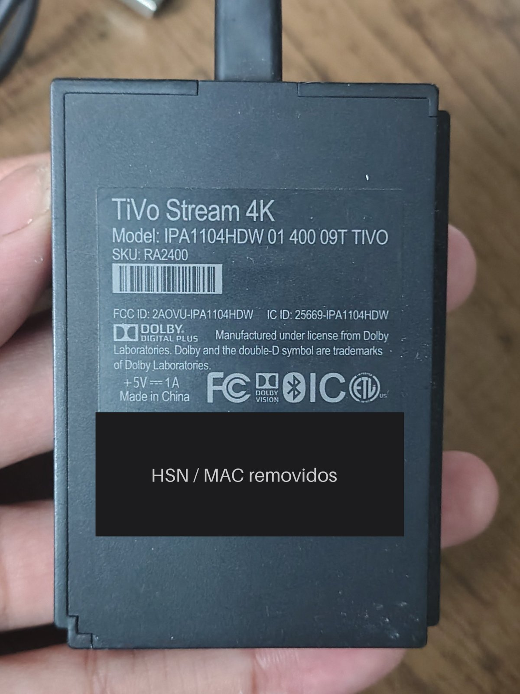

# 00 — Hardware e família do aparelho

## O que a etiqueta diz

| Campo | Valor | Por que importa |
|---|---|---|
| Modelo | `IPA1104HDW 01 400 09T TIVO` | Identifica a revisão de hardware |
| SKU | `RA2400` | Versão de varejo dos EUA |
| FCC ID | `2AOVU-IPA1104HDW` | `2AOVU` é o código de concessionário da **SEI Robotics** |
| Alimentação | 5 V ⎓ 1 A | Use uma fonte que entregue isso de verdade; USB da TV às vezes não basta e causa travadas |
| Selos | Dolby Vision, Dolby Digital Plus, Bluetooth | |

> Nunca publique o HSN e o MAC da etiqueta. As fotos do repositório já estão tarjadas.

## A descoberta que mais ajuda: a família SEI/NES

O TiVo não foi fabricado pela TiVo. Quem fez foi a SEI Robotics, que usa a middleware **NES** em vários aparelhos de operadoras. Isso significa que o TiVo tem "primos" já documentados no cleanyourtv:

| Aparelho | Lista no cleanyourtv | O que aprendemos com ele |
|---|---|---|
| Nokia Streaming Box 8000 (SEI600NK4, Android TV 14) | `examples/nokia-streaming-box-8000/` | Mesmo launcher clássico com aba "Loja"; o firmware **recusou** `pm disable-user` e teve que usar `pm suspend` + `appops`. `com.nes.coreservice` foi mantido lá porque mistura LED, mensagens de OTA e um receptor de analytics |
| Dialog ViU (SEI103DL, Android TV 9) | `examples/dialog-viu-sei103dl/` | `com.nes.blerc` (controle Bluetooth) e `com.nes.tvglobalkeyhandler` (botões do controle) são essenciais; `com.nes.skywayclient` faz anúncios de boot e instalações silenciosas |

O que se confirmou no aparelho (build `SC.1272`):

- [x] O TiVo recusa `pm disable-user`, como o Nokia: `Warning! This command is illegal!`. Funcionam `pm suspend` e `appops`, e `pm uninstall --user 0` só para apps que não são core.
- [x] Os pacotes `com.nes.*` presentes: `coreservice`, `daemon`, `tvbugtracker`, `tivo.quickset`, `tivo.remote.ota`, `tivo.remote.pair`, mais `com.tivo.sageservice`, `com.uei.uas.tivo` e `com.sei.hdmi.services`. O pareamento do controle, o CEC e o QuickSet são carga estrutural; o resto foi suspenso.
- [x] O `com.nes.coreservice` do TiVo faz as mesmas coisas que o do Nokia, mais a desinstalação: desinstala no boot uma lista fixa de 53 pacotes e todo app não-sistema que declare a categoria HOME. Ver [03](03-coreservice.md).
